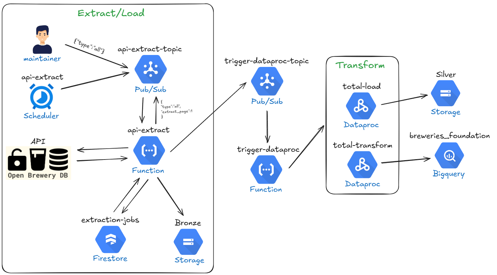
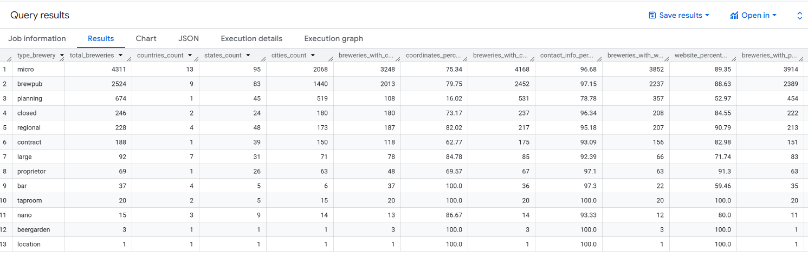
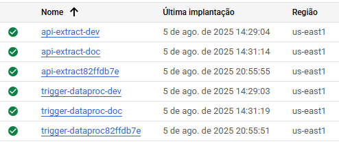
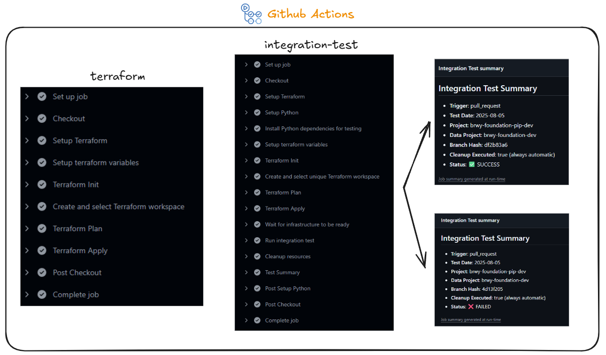

# brwy-foundation

Scalable system for extraction, processing, and analysis of brewery data using Google Cloud Platform via Terraform and the Breweries DB API. The project implements a medallion architecture (Bronze/Silver/Gold) with parallel processing and automated orchestration.

This process is designed for scalable operations in both processing and team structure, enabling work with large data volumes and parallel development.

## General Architecture

The system uses a distributed data pipeline with the following characteristics:

- **Scalability**: Parallel processing through Pub/Sub and Functions
- **Observability**: Centralized logs and data quality monitoring
- **Automation**: Complete CI/CD with integration tests enabling work across multiple development branches

### Pipeline Flow



### Data Layers

- **Bronze**: Raw data in JSON format organized by date
- **Silver**: Processed data in Parquet format with typing and cleansing
- **Gold**: Aggregated data in BigQuery with analytical views

## System Components

### Data Extraction (API-Extract Function)

This function is responsible for extracting data from the Open Brewery DB API with support for different extraction types:

- **`all`**: Complete extraction of all breweries
- **`by_state`**: Extraction by state (in development)
- **`by_type`**: Extraction by type (in development)

```json
{
  "type": "all", // can be by_state or by_type
  "extract_page": 1, // optional, for processing a specific page
  "state": "Busan", // required for by_state
  "brewery_type": "micro" // required for by_type
}
```

**Features:**

- The function starts the process by querying the metadata endpoint, calculates the number of pages, and self-triggers via Pub/Sub for each page.

- Each triggered page extracts the data and saves it in JSON format to the Bronze bucket, in addition to updating information in Firestore atomically (transactionally).

- Upon verifying that all files have been registered in Firestore, the function publishes a message to the `trigger-dataproc-topic` to trigger the transformation process.

#### JSON File Format (Bronze Bucket)
```
gs://bucket-bronze/YYYY-MM-DD/YYYY-MM-DD_page_XX.json
```

### Transactional Control (Firestore)

Manages extraction state through the `extraction_job` collection:
- Uses the @firestore.transactional decorator to register processed pages and query total pages, comparing with the number of processed pages.
- This process ensures extraction progress tracking and addresses concurrency issues, guaranteeing a single trigger for `trigger-dataproc`.

#### Firestore Document Structure
```json
{
  "date": "2025-08-05",
  "completed_pages": 
  {
    1:
    {
        "page_number": 1,
        "status": "completed",
        "processed_at": "2025-08-05T12:00:00Z"
        
    }
    ...
  }
  "total_pages": "43",
  "dataproc_triggered": false,
}
```

### Orchestration (Trigger Dataproc Function)

Function responsible for triggering Dataproc jobs based on extraction type:

- Dataproc template orchestration
- Dynamic parameter passing
- Execution monitoring

### Data Processing (Dataproc PySpark Jobs)

For the Dataproc process, the following configurations were used:
- **Machine Type**: n1-standard-2
- **Worker Nodes**: 2
- **Spark Properties**: Optimized configurations for BigQuery, dynamic allocation, and adaptive SQL.

#### Step total-load:
Transformation from JSON to Parquet (Bronze → Silver):
- Column renaming and standardization
- Appropriate field typing
- Date-based partitioning

#### Step total-transform:
Loading to BigQuery (Silver → Gold):
- Application of business rules
- Data quality validation
- Loading to `breweries-all-data` table

### Analytical Layer (BigQuery)

#### Main Table
- **`breweries-all-data`**: Consolidated data from all breweries
- Partitioned by date and clustered by type and state

**Table Fields:**
- `id_brewery` (STRING): Unique brewery identifier
- `name_brewery` (STRING): Brewery name
- `type_brewery` (STRING): Brewery type (micro, brewpub, etc.)
- `address_line_1` (STRING): First address line
- `address_line_2` (STRING): Second address line
- `address_line_3` (STRING): Third address line
- `name_city` (STRING): City name
- `name_state_province` (STRING): State or province name
- `value_postal_code` (STRING): Postal/ZIP code
- `name_country` (STRING): Country name
- `longitude` (FLOAT): Longitude coordinate
- `latitude` (FLOAT): Latitude coordinate
- `phone` (STRING): Phone number
- `url_website` (STRING): Website URL
- `name_state` (STRING): State abbreviation
- `name_street` (STRING): Street name
- `processing_date` (DATE): Record processing date
- `processing_timestamp` (TIMESTAMP): Processing timestamp
- `source_date` (DATE): Source data date
- `full_address` (STRING): Formatted full address
- `year` (INTEGER): Year from source date
- `month` (INTEGER): Month from source date
- `day` (INTEGER): Day from source date
- `has_coordinates` (BOOLEAN): Whether brewery has valid coordinates
- `has_contact_info` (BOOLEAN): Whether brewery has contact information

#### Aggregated Views

##### `breweries_agg_type` - Aggregation by brewery type
Aggregated metrics grouped by brewery type:

**Columns:**
- `type_brewery` (STRING): Brewery type (micro, brewpub, regional, etc.)
- `total_breweries` (INTEGER): Total breweries of this type
- `countries_count` (INTEGER): Number of unique countries
- `states_count` (INTEGER): Number of unique states
- `cities_count` (INTEGER): Number of unique cities
- `breweries_with_coordinates` (INTEGER): Breweries with valid coordinates
- `coordinates_percentage` (FLOAT): Percentage of breweries with coordinates
- `breweries_with_contact` (INTEGER): Breweries with contact information
- `contact_info_percentage` (FLOAT): Percentage of breweries with contact
- `breweries_with_website` (INTEGER): Breweries with website
- `website_percentage` (FLOAT): Percentage of breweries with website
- `breweries_with_phone` (INTEGER): Breweries with phone
- `phone_percentage` (FLOAT): Percentage of breweries with phone
- `latest_data_date` (DATE): Most recent data date
- `earliest_data_date` (DATE): Earliest data date
- `last_updated` (TIMESTAMP): Last processing update

##### `breweries_agg_state` - Aggregation by state
Aggregated metrics grouped by state:

**Columns:**
- `name_state` (STRING): State abbreviation
- `total_breweries` (INTEGER): Total breweries in state
- `countries_count` (INTEGER): Number of unique countries
- `states_count` (INTEGER): Number of unique states
- `cities_count` (INTEGER): Number of unique cities
- `breweries_with_coordinates` (INTEGER): Breweries with valid coordinates
- `coordinates_percentage` (FLOAT): Percentage of breweries with coordinates
- `breweries_with_contact` (INTEGER): Breweries with contact information
- `contact_info_percentage` (FLOAT): Percentage of breweries with contact
- `breweries_with_website` (INTEGER): Breweries with website
- `website_percentage` (FLOAT): Percentage of breweries with website
- `breweries_with_phone` (INTEGER): Breweries with phone
- `phone_percentage` (FLOAT): Percentage of breweries with phone
- `latest_data_date` (DATE): Most recent data date
- `earliest_data_date` (DATE): Earliest data date
- `last_updated` (TIMESTAMP): Last processing update

Example of breweries_by_type for one day:


## Infrastructure and Environments

### Environments

#### Development
- `brwy-foundation-dev`
- `brwy-foundation-pip-dev`
- Automatic replication per branch with "-branch" suffix, designed for parallel development in large teams
- Buckets and tables in development environment have deletion protection disabled

##### Example of replication in dev for branches and tests:


#### Production
- `brwy-foundation`
- `brwy-foundation-pip`

This approach enables separate management of access and costs for the engineering team and data users.

### CI/CD (GitHub Actions)


#### terraform.yml
- Automatic deployment on every push
- Redeployment of modified infrastructure
- Terraform syntax validation

#### integration-test.yml
- Creation of temporary infrastructure (hash suffix)
- Complete end-to-end testing:
  - Trigger of `test_api_extract`
  - Function log monitoring
  - Dataproc execution validation
  - BigQuery quality tests
- Automatic resource cleanup

## Operation and Monitoring

### Scheduling
- Daily execution at 09:00 (Brasília time)
- Day-by-day incremental history

### Temporal Storage
- The process is designed to maintain a historical record of data organized by extraction date, enabling tracking of brewery type changes and identification of new brewery registrations

## Project Structure

```
├── *.tf                      # Terraform files (infrastructure)
├── scr/
│   ├── functions/            # Cloud Functions
│   │   ├── api-extract/      # API data extraction
│   │   └── trigger-dataproc/ # Dataproc orchestration
│   └── dataproc/            # PySpark jobs
│       ├── breweries/
│       │   ├── load/         # total-load (JSON → Parquet)
│       │   └── transform/    # total-transform (Parquet → BigQuery)
├── scripts/                  # Utility scripts
├── tests/
│   ├── integration_test_runner.py  # Main test runner
├── integration/
|       ├── __init__.py
│       ├── test_infrastructure.py  # Infrastructure validation tests
│       ├── test_api_extract.py     # API Extract function tests
│       ├── test_dataproc.py        # Dataproc workflow tests
│       ├── test_bigquery.py        # BigQuery validation tests
│       ├── monitor_integration_test.sh     # Monitoring script
│       └── validate_bigquery_data.py       # Independent BigQuery validator
test/                     # Sample data
├── bronze/               # Raw sample data
└── silver/               # Processed sample data
└──.github/workflow/          # GitHub Actions
├── docs/                     # Documentation and diagrams
│   ├── pipeline.png          # Complete process flow
│   └── actions.png           # GitHub Actions workflows
```

## Technical References

- [Terraform GCP Guide](https://developer.hashicorp.com/terraform/tutorials/gcp-get-started/google-cloud-platform-build)
- [Setup Actions](https://developer.hashicorp.com/terraform/tutorials/gcp-get-started/google-cloud-platform-build)
- [Provider Setup](https://developer.hashicorp.com/terraform/language/providers/requirements#requiring-providers)
- [Build Trigger-Dataproc](https://cloud.google.com/python/docs/reference/dataproc/latest/google.cloud.dataproc_v1.services.workflow_template_serviceWorkflowTemplateServiceClient#google_cloud_dataproc_v1_services_workflow_template_service_WorkflowTemplateServiceClient_instantiate_workflow_template)
- [Settings BigQuery Connector](https://github.com/GoogleCloudDataproc/spark-bigquery-connector)
- [GitHub Actions Context](https://docs.github.com/en/actions/reference/workflows-and-actions/contexts)
